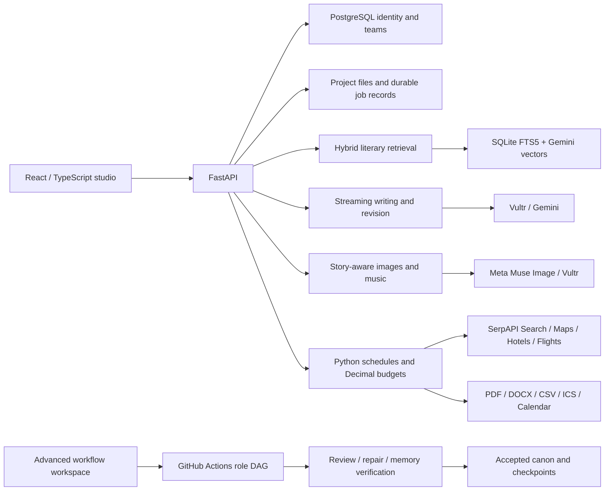

# ParaMyth

### From a story idea to a world you can write, visualize, score, and produce together.


[](https://github.com/TanishC4444/ParaMyth/actions/workflows/backend-tests.yml)
[](https://github.com/TanishC4444/ParaMyth/actions/workflows/website.yml)

[Explore the studio](https://paramyth.tech) · [Architecture](docs/ARCHITECTURE.md) · [Engineering evidence](docs/ENGINEERING.md) · [Run locally](#run-locally)

**HackTX 2026 — 3rd Place, Best Use of SerpAPI.**

**Read the implementation:** [Writing backend](#inside-the-interactive-writing-backend) ·
[Agent layers](#the-advanced-agent-orchestration-layers) · [Retrieval](#literary-retrieval-step-by-step) ·
[SerpAPI and planning](#serpapi-from-fictional-requirements-to-real-production-leads) ·
[Tiger and storage](#tiger-data-collaboration-and-durable-project-storage)

ParaMyth is a collaborative creative studio for writers and filmmakers. Discover
literary references on a 3D Story Atlas, develop a shared manuscript, generate
story-aware imagery and music, and turn scenes into researched production plans.
The writing, references, visual direction, schedules, and budget stay attached to
the same project.

The main studio runs React/TypeScript and FastAPI. A separate advanced engine
experiments with multi-agent writing: character proposals, parallel reviews,
source-bound memory, targeted repairs, and explicit acceptance gates distributed
across GitHub Actions runners.

## What you can do

| Start with | Build toward | Implementation |
| --- | --- | --- |
| An idea or narrative situation | Literary references on an interactive globe; keyword and semantic discovery | [Retrieval](paramyth/rag/db.py), [Atlas](frontend/src/atlas.ts) |
| A brief and characters | Streamed chapters, editable drafts, review, revision, and a shared manuscript | [Creative engine](paramyth/pipeline/creative_studio.py) |
| A passage or reference image | Character, scene, location, prop, or storyboard imagery with Meta Muse Image | [Images](paramyth/image_studio.py), [reference images](paramyth/image_references.py) |
| Writing and musical direction | Generated soundtracks through Vultr, or locally synthesized ambience | [Soundtracks](paramyth/pipeline/media_workspace.py) |
| A scene and filming constraints | Location/supplier research, shoot schedules, budget ranges, and production tasks | [Planner](paramyth/pipeline/production.py) |
| A real-world documentary topic | Source leads, cited provisional claims, interview questions, and a research dossier | [Research](paramyth/studio/research.py) |
| A creative team | Permissioned studios, revision history, comments, and conflict-aware edits | [Teams](paramyth/studio/team_workspace.py) |

## Model stack and backend responsibilities

| Layer | What actually runs | Responsibility |
| --- | --- | --- |
| Interactive writing and production reasoning | Vultr Serverless Inference, `muse-glimmer-30b` | Stream drafts/revisions; propose validated scene breakdowns, visual direction, resources, and production plans |
| Visual generation | Meta Model API, `muse-image-1.0` | Render story-conditioned characters, scenes, props, locations, and storyboard images; retain source signatures and reference-image identities |
| Soundtracks | Vultr music-model discovery and asynchronous jobs | Generate and archive audio; local procedural ambience provides a separate path |
| Literary search | Gemini `gemini-embedding-001`, 768 dimensions; SQLite FTS5/BM25 | Retrieve from 605 literary records (603 enabled) using cosine similarity and weighted reciprocal-rank fusion |
| Identity and collaboration | Tiger Cloud/PostgreSQL through Psycopg | Accounts, hashed sessions, memberships, invitations, revisions/comments, and owner/admin/editor/viewer authorization |
| Manuscripts, media, and work execution | Persistent project files, FastAPI, bounded Python background workers | Save drafts and generated artifacts, stream progress, retain interrupted-job state, and track source ownership |
| External production intelligence | SerpAPI Google Search, Maps, Hotels, Flights | Research filming regions, suppliers, accommodation, and airfares; preserve dated source evidence for schedules and budgets |

The advanced engine adds an explicit orchestration stack: **retrieval and refinement
→ planning/scene contracts → character proposals → direction and writing → editing
→ parallel story/rhetoric review and memory extraction → targeted repair → independent
memory verification → acceptance and canon**. Its shared executor handles scoped
packets, model routing, schemas, budgets, retries, and diagnostics; Actions artifacts
carry state between separate role runners. Hosted Google routes and GH-INFERENCE/
llama.cpp CPU workers are configurable there. Interactive chapter generation runs
on the FastAPI backend and does not execute that entire Actions graph.

Tiger stores relational identity and collaboration records. The literary vector
index and research cache use SQLite; manuscripts and media live in persistent
project directories. These stores have distinct ownership and backup requirements.
[See the complete request lifecycles and orchestration boundaries →](docs/ARCHITECTURE.md)

## Engineering worth opening the code for

- **605 indexed literary records; 603 enabled for retrieval.** Each has a normalized
  **768-dimensional Gemini embedding**. Search fuses cosine-similarity rankings with
  SQLite FTS5/BM25 using weighted reciprocal ranks; corpus fingerprints prevent
  incomplete or incompatible indexes from silently entering the main search path.
- **Four SerpAPI engines:** Google Search, Maps, Hotels, and Flights. A shared adapter
  normalizes results, caches research in SQLite, reserves rolling daily allowances
  transactionally, and cools down exhausted credentials before ordered failover.
- **Source-bound agent memory.** Paragraph IDs, character offsets, and SHA-256 prose
  hashes tie extracted facts and repairs to exact candidate text. Append-only canon
  validates supersession; character packets filter knowledge before projecting state.
- **Deterministic production arithmetic.** Python schedules scene dependencies around
  availability, setup/moves, meals, day/night windows, and turnaround; `Decimal`
  calculates budget ranges. Operations cover **18 production departments** with
  bounded task graphs and researched travel allowances.
- **Four collaboration roles:** owner, admin, editor, viewer. PostgreSQL stores
  identity and memberships; server-side authorization and revision hashes protect
  shared work. Each member retains their own Calendar authorization.

Counts describe checked-in data and implemented scope, not traffic, throughput,
or demonstrated improvements in writing quality. [See sources and checks →](docs/ENGINEERING.md)

## Architecture



The interactive studio performs writing jobs on the application backend. It does
not dispatch the advanced Actions graph for each chapter. Identity/team records,
literary retrieval, community posts, and project files have different storage
responsibilities. [Read the request paths and design tradeoffs →](docs/ARCHITECTURE.md)

## Walkthrough: one project from premise to production

Consider a writer developing a coastal mystery with a small filmmaking team. This
is an example of how the components fit together, not a claimed live benchmark.

1. **Find a useful reference.** Search for a narrative situation such as a keeper
   hiding a dangerous secret. The Atlas presents matching literary records in
   their geographic context. A match supplies a reference and its source limits;
   it does not prescribe a plot to copy.
2. **Develop and write.** Define the premise, characters, medium, point of view,
   and constraints. Ask for a draft, inspect the stream, edit the result, and adopt
   a chosen version into the manuscript. Later chapter requests can include
   earlier selected writing from that project.
3. **Give the team a common visual reference.** Choose a chapter or passage and
   request a character, location, prop, or storyboard image. The image direction
   draws from that selected writing; uploaded reference images can guide the
   render. Generate music from the same story material when useful.
4. **Make the story filmable.** Supply a filming region, dates, crew constraints,
   and budget ceiling. The planner breaks writing into scenes, calculates a shoot
   schedule, researches locations and logistics, and builds budget ranges and tasks.
5. **Review and share.** Work in a permissioned team studio, compare revisions,
   discuss choices, and export the materials. Community Discovery shares an
   explicitly selected snapshot rather than exposing the private project folder.

The connection between these steps is the project and its selected source
material. Writing, image generation, music, and production have separate jobs and
artifacts; they can retain the identity of the writing snapshot that informed them.

## Inside the interactive writing backend

The browser does not call model providers directly. React sends a project-scoped
request to FastAPI, which resolves the authorized workspace, validates the input,
and creates a background job. The server retains provider credentials and sends
only the context needed for that operation.

[The creative engine](paramyth/pipeline/creative_studio.py) supports idea
development, drafting, review, revision, and bounded loops. It preserves the
writer's premise, medium, characters, and explicit restrictions. Earlier writing
is selected from the same project in reading order; future chapters and unrelated
projects do not become automatic context. Context remains bounded, so this is not
a promise that every word in a long manuscript appears in every model request.

### What each model does

**Vultr Muse Glimmer (`muse-glimmer-30b`)** supplies creative text through Vultr
Serverless Inference. The interactive adapter consumes server-sent events, extracts
text deltas, and retains provider usage when returned. It can show a partial draft
while generation is running. Finish-reason and JSON checks distinguish a complete
answer from a truncated or interrupted stream. The same model family supports
production breakdowns and optional visual-prompt development through separate
requests; a text draft does not automatically run production planning.

**Meta Muse Image (`muse-image-1.0`)** renders the visual. Its input can include
story-conditioned direction and validated project reference images. Generation
records preserve model/provider, prompt, reference IDs, result state, and image
metadata. Rendered PNGs are validated before being treated as completed media.
Muse Glimmer's prompt-development role and Muse Image's rendering role are two
different operations.

**Vultr music models** supply asynchronous audio generation. Model discovery
reports available capabilities before submission; job status and output handling
are separate from text streaming. The media workflow can archive completed tracks
and keep their source-writing association. Locally synthesized ambience is another
path and does not require a remote music generation call. A music model's current
capabilities determine supported durations and lyric requirements.

**Gemini** provides literary embeddings and configurable text routes. The main
creative adapter can use a configured Gemini model when the Vultr text key is
absent. Advanced orchestration has more detailed per-role routing policies; its
hosted routes and CPU fallbacks should not be confused with the simple provider
selection in the interactive writer.

### Drafts, manual edits, and selected passages

A generation result, the currently selected draft, manual edits, and the saved
manuscript are distinct states. Selecting an older draft does not erase newer
results. Edits retain their base-generation identity, so the UI can resolve which
text the writer is actually working on.

For a passage revision, the engine first resolves one unambiguous span in the
current text. It rejects ambiguous or stale selections and checks that a proposed
replacement does not repeat unrelated surrounding paragraphs. The rest of the
chapter remains intact. This is a narrower operation than asking a model to
rewrite the entire document and trusting it to preserve everything else.

Implementation: [creative studio](paramyth/pipeline/creative_studio.py),
[stream decoding](paramyth/pipeline/creative_stream.py),
[image generation](paramyth/image_studio.py),
[reference images](paramyth/image_references.py),
[media source resolution](paramyth/pipeline/media_workspace.py).

## The advanced agent orchestration layers

The advanced engine exposes role boundaries that a single undifferentiated chat
call would hide. The exact graph varies by workflow and policy; fast modes may
forward or combine a stage instead of making another model call.

| Layer | Input and responsibility | Result passed forward |
| --- | --- | --- |
| Retrieval | Interpret the brief's themes, conflicts, relationships, and craft needs | Source IDs, mechanisms, limitations, and role-specific craft packets |
| Refinement and development | Preserve explicit author choices; develop missing detail as labelled proposals | Refined brief and development feedback |
| Planning and scene contracts | Establish ordering, point of view, participants, dependencies, and intended changes | Outline and scene cards |
| Character proposals | Give each participating character only the facts available to that character | Scoped proposed actions |
| Direction, writing, and editing | Turn the scene contract and proposals into candidate prose | Draft plus editing records |
| Independent review | Evaluate story and rhetoric against the same candidate; extract proposed memory separately | Reviews and evidence-linked candidate facts |
| Targeted repair | Address cited passages and reconcile conflicting proposed replacements | Revised candidate and a patch report |
| Memory verification | Check proposed facts against the exact source and accepted-state context | Verified or rejected memory updates |
| Acceptance and continuation | Apply the workflow's quality/memory gates | Accepted state, canon history, and the next checkpoint |

### How work moves between stages

[The shared Executor](paramyth/pipeline/inference.py) binds role instructions,
context, model choice, output schema, output budget, validation, bounded retries,
caching, and diagnostics. Saved packets make the actual model input inspectable;
call records retain outputs and available timing/usage data. Changing a role's
context or model is an execution-policy decision rather than an implicit side
effect of a shared conversation history.

[Native Actions workflows](.github/workflows/story.yml) declare role jobs and
matrix branches. Jobs upload their products; downstream jobs download the
artifacts they need. Character proposals and independent review branches can run
on different runners. Later scenes still depend on the accepted state of earlier
scenes in the sequential workflow. Parallel-scene reconciliation and living-universe
continuation have their own graphs and acceptance policies.

GH-INFERENCE and llama.cpp provide local CPU inference inside allocated runners;
configured hosted Google routes provide another execution path. CPU calls within
a runner can be serialized to avoid competing model loads. Additional runner
branches only overlap when GitHub capacity is available; the graph alone is not
evidence of a measured speedup.

### Why source-bound memory matters

Suppose a scene establishes that one character hides a key while another is
absent. A summary saying “the key is hidden” is insufficient if every later agent
receives that fact as shared knowledge. ParaMyth keeps the source and knowledge
visibility separate: the author may know the event, while the absent character's
packet does not automatically gain it.

[Evidence binding](paramyth/pipeline/evidence.py) maps proposed memories to
paragraph IDs, source offsets, and a SHA-256 hash of the candidate prose. Unknown
IDs and stale hashes are rejected. [Paragraph patches](paramyth/pipeline/patching.py)
verify the target version and replace only addressed spans. A review of one prose
version cannot silently certify a changed candidate.

[Canon](paramyth/pipeline/canon.py) retains append-only history. A new fact that
supersedes an old one must identify the earlier record and preserve the fact key
and kind. Visibility filtering happens before the character's current-state
projection, allowing an uninformed character to retain an earlier belief. Full
history and the bounded working packet have different purposes.

Strict acceptance requires the configured gates. Explicit provisional modes may
keep writing with unresolved checks, but label the draft and its reports
accordingly. Source binding proves where text came from; independent model checks
can still misinterpret it.

## Literary retrieval, step by step

The index contains **605 records**, including **603 enabled records**, with
**768-dimensional Gemini embeddings**. The full record is retained alongside a
retrieval projection, identity, enabled flag, and vector.

1. Build the document projection from the record's relevant text and metadata.
2. Create task-typed document embeddings with `gemini-embedding-001` and normalize
   the vectors. Query embeddings use the separate retrieval-query task type.
3. At search time, filter enabled records and rank keyword matches with SQLite
   FTS5/BM25. Keyword-only search can run without embedding credentials.
4. For semantic search, compare normalized query and document vectors with a
   NumPy matrix/vector product.
5. Combine the two ranked lists with weighted reciprocal-rank fusion. A record's
   contribution depends on its rank in each channel, avoiding an assumption that
   raw BM25 and cosine scores share one scale.
6. Apply the selected grouping/diversification policy and return inspectable source
   IDs. Advanced retrieval additionally supports weighted query facets, mechanism
   overlap, pinned explicit references, and role-specific craft context.

[Ingestion](paramyth/rag/ingest.py) compares stored projections before requesting
new embeddings. Unchanged rows can be reused; outstanding batches leave the main
index incomplete until completion metadata is published. Version and fingerprint
checks guard compatibility. The committed-index regression exercises the actual
bundled SQLite artifact so a valid temporary test index cannot mask a broken
fresh checkout.

The corpus's analyses are model-authored material with recorded source limits.
Retrieval selects useful context; it does not establish historical influence,
originality, or a measured improvement in prose quality.

## SerpAPI: from fictional requirements to real production leads

Production research starts with the story and the user's filming constraints.
A story's setting is not automatically its shooting location, and the user's
timezone is not evidence of where the crew lives. Region proposals, dates,
headcount, currency, and explicit constraints determine what is researched.

| Engine | Research performed | How it enters the plan |
| --- | --- | --- |
| Google Search | Film offices, permits, location libraries, published rates, documentary source leads | Dated public links/snippets with source IDs; optional evidence-backed recommendations |
| Google Maps | Catering, passenger transport, camera/lighting/sound suppliers, medical facilities | Local logistics alternatives attached to the filming region |
| Google Hotels | Accommodation for the proposed shoot dates | Room-night rate leads, amenities, location, and explicit occupancy assumptions |
| Google Flights | Return travel between supplied airports/dates | Per-traveler fare leads with itinerary and duration information |

Hotel dates are derived from the shoot schedule. Room estimates use headcount and
an explicit occupancy assumption. Flight research needs a departure airport and a
confirmed destination; missing information remains a gap rather than being guessed
from the user's locale. Alternatives retain their own identities so one supplier's
price is not attributed to another supplier.

### Caching, quotas, and failure handling

[The shared adapter](paramyth/production_research.py) normalizes query/options into
a hashed cache key. Legal research expires after 6 hours; other research expires
after 24 hours. Cached results remain available when the network allowance is
exhausted.

Before a provider call, SQLite `BEGIN IMMEDIATE` serializes a reservation against
the rolling 24-hour attempt allowance. Per-plan limits bound a single planning
session. Ordered failover considers at most three configured keys, and exhausted
credentials enter a one-hour cooldown. A failed attempt still counts as an attempt;
there is no claim that only successful queries consume provider quota.

Maps, Hotels, and Flights containers and nested fields are validated before
caching. Malformed responses become controlled provider failures, not internal
Python errors or cached bad records. They do not trigger blind sweeps through
backup credentials. Source records retain public URLs and retrieval times rather
than credential-bearing request URLs.

### Research is evidence, not arithmetic

Muse Glimmer proposes structured scenes, resource rows, and production advice.
Python then validates and calculates the plan:

- **Scene scheduling** respects dependencies, cast/location availability,
  setup/move time, meal breaks, day/night groupings, and 12-hour turnaround.
  Unscheduled scenes remain visible when constraints cannot be satisfied.
- **Budget ranges** use `Decimal` for quantities, rates, contingency, and totals.
  Unknown costs remain explicit; a generated estimate is not a booking quote.
- **Detailed operations** cover 18 departments with at most 40 tasks. Task
  dependencies must be acyclic, and owner scheduling prevents overlapping tasks
  for the same proposed role. Infeasible preparation lead times are reported.
- **Published-rate replacement** requires supplied source IDs, a verbatim supporting
  snippet, matching numeric amounts, currency, and billing unit. Unsupported
  conversions and invented source IDs are rejected.
- **Local recalculation** can update scenes, schedules, and budgets without another
  model request. Earlier logistics research is marked stale when appropriate.

Plans retain their configuration, source files, breakdown, schedule, budget,
operations, logistics, recommendations, evidence, model-call records, and warnings.
CSV, ICS, JSON, document dossiers, and call sheets expose those outputs. Calendar
sync checks overlapping events and uses stable identities to avoid duplicates.

The scheduler is a bounded single-unit heuristic. Search results and price leads
still need availability, permit, tax, and scope checks before a real shoot.
Implementation: [planner](paramyth/pipeline/production.py),
[operations](paramyth/pipeline/production_operations.py),
[price evidence](paramyth/pipeline/production_intelligence.py),
[Calendar](paramyth/calendar_sync.py).

## Tiger Data, collaboration, and durable project storage

Tiger Cloud/PostgreSQL is the relational foundation for identity and teams, accessed
through Psycopg. It does not hold every generated file or serve as the literary
vector database.

| Store | Data it owns | Why it is separate |
| --- | --- | --- |
| Tiger Cloud/PostgreSQL | Users, password hashes, sessions, studios, memberships, invitations, SQL revisions/comments | Transactional identity, membership, and permission relationships |
| Persistent project directories | Manuscripts, selected drafts, revisions, generated media, job records, plan artifacts | Large creative artifacts and inspectable project-local history |
| Literary SQLite database | Records, embeddings, FTS index, completion metadata | Portable corpus and hybrid retrieval |
| Research SQLite cache | Cached responses, quota reservations, credential cooldowns | Shared search accounting and repeat-query reuse |
| Community SQLite database | Explicit public snapshots, revisions, reports | Publishing a snapshot remains separate from exposing private work |

### Editing with a team

Owners and admins manage a studio; authorized editors can work on its content;
viewers retain read access. Permissions are checked on server requests. Sharing a
project creates a studio-owned copy; members share its project runtime and files
while keeping personal selection and Calendar authorization separate.

Project saves compare revision hashes. Draft-field updates compare individual field
hashes, allowing separate workspace tabs to change different fields without
replacing the whole draft object. A stale conflicting write returns HTTP 409 and
keeps the writer's local changes available for comparison. Refresh/polling and
explicit conflict handling support collaboration; this is not an OT/CRDT editor.

### Authentication and recovery boundaries

Passwords use salted scrypt, sessions use hashed opaque tokens with expiry and
revocation, and authentication throttling persists in SQL. Hosted requests apply
host/origin and CSRF checks. Runtime SQL uses a restricted role; migrations run
explicitly with a separate connection. These are implementation choices supported
by tests, not a security certification.

[Atomic project saves](paramyth/storage.py) write a temporary file, flush/fsync,
and replace the destination. Background jobs use a bounded in-process pool with
saved status and results. After a restart, unfinished jobs become `interrupted`;
the saved record does not pretend the computation is still running. The hosted
setup uses one application process/replica with a persistent volume. Complete
backups need the database, project volume, and encryption key.

The documented deployment serves the frontend through GitHub Pages and runs the
FastAPI backend and private storage on Railway. Split-origin configuration permits
the exact frontend origin; provider secrets stay on the server. See
[Railway deployment](deploy/railway.md) and [Tiger setup](docs/TIGER.md) for the
configuration and migration procedure.

## Run locally

Use **Python 3.11+**, **Node.js 22.12+ or 24**, and **pnpm**.

```sh
git clone https://github.com/TanishC4444/ParaMyth.git
cd ParaMyth
python -m venv .venv
# macOS/Linux
source .venv/bin/activate
# Windows PowerShell: .venv\Scripts\Activate.ps1
python -m pip install -e ".[studio,tiger,api,rag,docx,hosted,production,test]"
cd frontend
pnpm install --frozen-lockfile
pnpm build
cd ..
python -m paramyth.studio.serve --port 8770
```

Open **http://127.0.0.1:8770**. The Atlas, manuscript editing, and keyword search
work without model credentials. Generation requires the relevant server-side
provider keys. Local personal mode should leave `PARAMYTH_ACCOUNT_WORKSPACES`
unset or `0` and `PARAMYTH_PUBLIC_ORIGIN` unset. The sample environment file uses
hosted account settings; configure it deliberately.

For frontend development, run `pnpm dev` in `frontend/`; its backend proxy defaults
to port 8770. The separate `frontend-pipeline/` workspace builds independently and
runs with `paramyth-pipeline-studio --port 8770`.

### Provider connections

| Capability | Server-side configuration |
| --- | --- |
| Literary embeddings and Gemini writing | `GEMINI_API_KEY` |
| Vultr writing and music | `VULTR_INFERENCE_API_KEY`; optional dedicated production/music keys |
| Meta images | `MUSE_IMAGE_API_KEY` (`MODEL_API_KEY` alias supported) |
| Production and documentary research | `SERPAPI_API_KEY`; optional `SERPAPI_BACKUP_KEYS` |
| Accounts and teams | `PARAMYTH_DATABASE_URL`, persistent `PARAMYTH_ENCRYPTION_KEY` |
| Calendar OAuth | `GOOGLE_CLIENT_ID`, `GOOGLE_CLIENT_SECRET` |

See [.env.example](.env.example) for exact variables and [integration details](docs/INTEGRATIONS.md)
for request paths. Provider keys stay on the backend. Configure current model IDs
and account access for your own provider accounts.

## Verify it

```sh
python -m unittest discover -s tests -v
python -m scripts.copy_lint --strict
cd frontend
pnpm test
pnpm exec tsc --noEmit
pnpm build
```

**Latest local check, October 26, 2026:** 802 backend tests passed; 35 PostgreSQL
integration tests were skipped because no disposable database was configured.
All **47 frontend tests**, TypeScript checking, and the production build passed.
These are local results; remote CI status is reported by the workflow badges and
checks on GitHub. The build retains a Three.js chunk-size advisory.

Database integration is exercised by the [Tiger CI workflow](.github/workflows/tiger.yml),
which starts disposable PostgreSQL and uses a restricted application role. For
local database checks, follow [the database guide](docs/TIGER.md) and [the earlier full database QA](docs/backend-qa.md).
Provider fixtures and mocks verify contracts; they do not establish live access,
output quality, or production uptime.

## Explore the repository

| Area | Start here |
| --- | --- |
| System boundaries, request lifecycles, and tradeoffs | [Architecture](docs/ARCHITECTURE.md) |
| Verifiable technical claims and reproduction | [Engineering evidence](docs/ENGINEERING.md) |
| Provider integrations and HackTX implementation | [Integrations](docs/INTEGRATIONS.md) |
| Sequential, parallel, and living-universe workflows | [Pipeline guide](docs/pipeline/README.md), [three modes](docs/pipeline/THREE_MODES.md) |
| Matched continuity experiments | [Demo design and limitations](demos/README.md) |
| Deployment and persistent volumes | [Hosting](docs/HOSTING.md), [Railway](deploy/railway.md) |
| Accounts, roles, and migrations | [Tiger setup](docs/TIGER.md) |
| Frontend and API | [Frontend](frontend/README.md), [advanced API](docs/pipeline/API.md) |
| Contributions and local checks | [Contributing](CONTRIBUTING.md) |

## Current limits

Generated text, factual synthesis, media, and budgets remain editable proposals.
Search snippets are leads; source binding verifies text identity, not whether a
claim or model judgment is correct. The scheduler is a single-unit heuristic,
not a global optimizer, and researched fares/rates require availability checks.

The server uses an in-process worker pool and saved job records, rather than a
distributed queue. A restart marks unfinished jobs interrupted. Deployment uses
one application process/replica with persistent project storage; backups need the
workspace, database, and encryption key. Long narrative runs depend on context,
provider quotas, runner availability, and fallible model reviews. The continuity
demos are exploratory comparisons, not evidence of a measured quality advantage.

## License and credits

Original project code is [MIT licensed](LICENSE). Vendored libraries, model terms,
corpus sources, fonts, and artwork retain their own provenance and terms.
[PROVENANCE.json](PROVENANCE.json), [art credits](frontend/public/art/manifest.json),
and [geography sources](frontend/public/atlas/GEOGRAPHY.md) record those boundaries.
Curated artwork and fixture prose are distinct from newly generated results.
