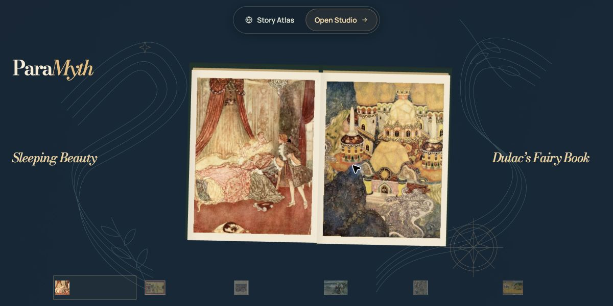

# ParaMyth

A creative workspace for exploring stories, developing writing, visual references, sound, and production plans. The public frontend includes an illustrated storybook and a searchable 3D atlas with 385 bundled story records.

## Quick preview

Requires Node.js 22.12+ and pnpm. No model credentials are needed for the landing page and bundled atlas.

```sh
cd frontend
pnpm install --frozen-lockfile
pnpm dev
```

Open the URL Vite prints. Use Story Atlas to browse or search; generation and workspace actions require the backend.

## Full studio

Requires Python 3.11+. From the repository root:

```sh
python -m venv .venv
source .venv/bin/activate
python -m pip install -e ".[studio,tiger,api,rag,docx,hosted,production,test]"
cd frontend
pnpm build
cd ..
python -m paramyth.studio.serve --port 8770
```

Open `http://127.0.0.1:8770`. Configure only the backend services you need using `.env.example`. Keep provider credentials on the server. See [hosting](docs/HOSTING.md) for deployment and the separate `studio-auth` branch for account/team work.

## Verified status

The frontend passed its production build, TypeScript check, and all 40 existing frontend tests. The landing page, globe, and atlas search were checked locally. Backend generation, paid providers, collaboration, and deployment were not retested during this pass.

[Frontend guide](frontend/README.md) · [Advanced pipelines](docs/pipeline/README.md)



[Detailed project guide](docs/project-guide.md)
