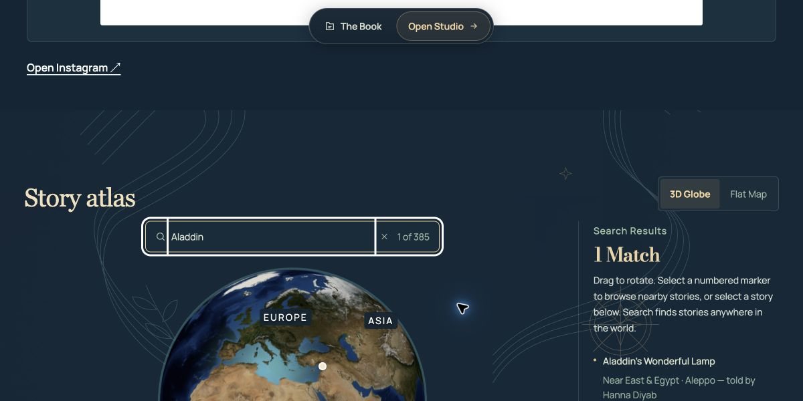

# ParaMyth

A storytelling workspace for exploring ideas, developing manuscripts, generating visual references, and planning productions. Its public landing page includes an interactive story atlas with 385 bundled records.



## Quick preview

Requires Git, Node.js 22.12+ (or Node.js 24), and pnpm. No provider credentials are needed for the landing page and bundled atlas.

```sh
git clone https://github.com/TanishC4444/ParaMyth.git
cd ParaMyth/frontend
pnpm install --frozen-lockfile
pnpm dev
```

Open the URL Vite prints, then choose Story Atlas. Search and browse the bundled stories. Project saving and generation require the backend. Stop with Ctrl+C.

## Run the studio

Also requires Python 3.11+. From the repository root:

```sh
python -m venv .venv
source .venv/bin/activate
python -m pip install -e ".[studio,tiger,api,rag,docx,hosted,production,test]"
cd frontend
pnpm install --frozen-lockfile
pnpm build
cd ..
python -m paramyth.studio.serve --workspace ../paramyth-local-workspace --port 8770
```

On Windows, activate with `.venv\Scripts\activate`. Open <http://127.0.0.1:8770>. To connect providers, copy `.env.example` to the ignored `.env` and fill only the services you intend to use. For local use, replace its hosted `/data` workspace value with the absolute path of `../paramyth-local-workspace`; leave public-origin settings blank. Missing provider settings disable their connected features. Keep credentials on the server and local workspace data outside commits.

`main` uses browser-scoped guest workspaces when hosted. Account/team development is on the separate `studio-auth` branch. Follow [main-branch deployment](deploy/railway.md) or the [account-branch hosting guide](docs/HOSTING.md) for the appropriate version.

## Check your setup

From `frontend/`:

```sh
pnpm exec tsc --noEmit
pnpm test:atlas
pnpm test:cinematic
pnpm test:site
pnpm build
```

The frontend passed its type check, production build, and 40 tests. Separate live checks verified guest project creation/reload, workspace isolation, origin rejection, text generation, and Muse image generation. Music, Google OAuth, and every provider path are not covered by those checks.

If studio actions fail in Vite, start the backend on port 8770; Vite proxies to it by default. If the full server shows API-only output, build `frontend/` first. Provider errors require checking that provider's settings and access.

[Frontend guide](frontend/README.md) · [Pipeline guide](docs/pipeline/README.md) · [Detailed project notes](docs/project-guide.md)
