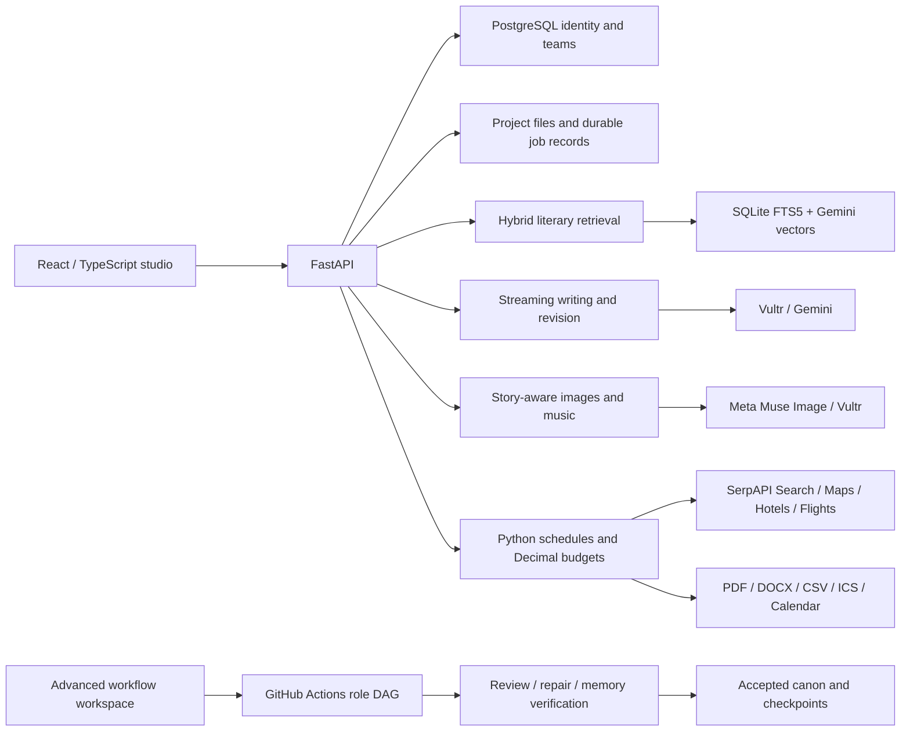

# ParaMyth

### From a story idea to a world you can write, visualize, score, and produce together.


[](https://github.com/TanishC4444/ParaMyth/actions/workflows/backend-tests.yml)
[](https://github.com/TanishC4444/ParaMyth/actions/workflows/website.yml)

[Explore the studio](https://paramyth.tech) · [Architecture](docs/ARCHITECTURE.md) · [Engineering evidence](docs/ENGINEERING.md) · [Run locally](#run-locally)

**HackTX 2026 — 3rd Place, Best Use of SerpAPI.**

ParaMyth is a collaborative creative studio for writers and filmmakers. Discover
literary references on a 3D Story Atlas, develop a shared manuscript, generate
story-aware imagery and music, and turn scenes into researched production plans.
The writing, references, visual direction, schedules, and budget stay attached to
the same project.

The main studio runs React/TypeScript and FastAPI. A separate advanced engine
experiments with multi-agent writing: character proposals, parallel reviews,
source-bound memory, targeted repairs, and explicit acceptance gates distributed
across GitHub Actions runners.

## What you can do

| Start with | Build toward | Implementation |
| --- | --- | --- |
| An idea or narrative situation | Literary references on an interactive globe; keyword and semantic discovery | [Retrieval](paramyth/rag/db.py), [Atlas](frontend/src/atlas.ts) |
| A brief and characters | Streamed chapters, editable drafts, review, revision, and a shared manuscript | [Creative engine](paramyth/pipeline/creative_studio.py) |
| A passage or reference image | Character, scene, location, prop, or storyboard imagery with Meta Muse Image | [Images](paramyth/image_studio.py), [reference images](paramyth/image_references.py) |
| Writing and musical direction | Generated soundtracks through Vultr, or locally synthesized ambience | [Soundtracks](paramyth/pipeline/media_workspace.py) |
| A scene and filming constraints | Location/supplier research, shoot schedules, budget ranges, and production tasks | [Planner](paramyth/pipeline/production.py) |
| A real-world documentary topic | Source leads, cited provisional claims, interview questions, and a research dossier | [Research](paramyth/studio/research.py) |
| A creative team | Permissioned studios, revision history, comments, and conflict-aware edits | [Teams](paramyth/studio/team_workspace.py) |

## Model stack and backend responsibilities

| Layer | What actually runs | Responsibility |
| --- | --- | --- |
| Interactive writing and production reasoning | Vultr Serverless Inference, `muse-glimmer-30b` | Stream drafts/revisions; propose validated scene breakdowns, visual direction, resources, and production plans |
| Visual generation | Meta Model API, `muse-image-1.0` | Render story-conditioned characters, scenes, props, locations, and storyboard images; retain source signatures and reference-image identities |
| Soundtracks | Vultr music-model discovery and asynchronous jobs | Generate and archive audio; local procedural ambience provides a separate path |
| Literary search | Gemini `gemini-embedding-001`, 768 dimensions; SQLite FTS5/BM25 | Retrieve from 605 literary records (603 enabled) using cosine similarity and weighted reciprocal-rank fusion |
| Identity and collaboration | Tiger Cloud/PostgreSQL through Psycopg | Accounts, hashed sessions, memberships, invitations, revisions/comments, and owner/admin/editor/viewer authorization |
| Manuscripts, media, and work execution | Persistent project files, FastAPI, bounded Python background workers | Save drafts and generated artifacts, stream progress, retain interrupted-job state, and track source ownership |
| External production intelligence | SerpAPI Google Search, Maps, Hotels, Flights | Research filming regions, suppliers, accommodation, and airfares; preserve dated source evidence for schedules and budgets |

The advanced engine adds an explicit orchestration stack: **retrieval and refinement
→ planning/scene contracts → character proposals → direction and writing → editing
→ parallel story/rhetoric review and memory extraction → targeted repair → independent
memory verification → acceptance and canon**. Its shared executor handles scoped
packets, model routing, schemas, budgets, retries, and diagnostics; Actions artifacts
carry state between separate role runners. Hosted Google routes and GH-INFERENCE/
llama.cpp CPU workers are configurable there. Interactive chapter generation runs
on the FastAPI backend and does not execute that entire Actions graph.

Tiger stores relational identity and collaboration records. The literary vector
index and research cache use SQLite; manuscripts and media live in persistent
project directories. These stores have distinct ownership and backup requirements.
[See the complete request lifecycles and orchestration boundaries →](docs/ARCHITECTURE.md)

## Engineering worth opening the code for

- **605 indexed literary records; 603 enabled for retrieval.** Each has a normalized
  **768-dimensional Gemini embedding**. Search fuses cosine-similarity rankings with
  SQLite FTS5/BM25 using weighted reciprocal ranks; corpus fingerprints prevent
  incomplete or incompatible indexes from silently entering the main search path.
- **Four SerpAPI engines:** Google Search, Maps, Hotels, and Flights. A shared adapter
  normalizes results, caches research in SQLite, reserves rolling daily allowances
  transactionally, and cools down exhausted credentials before ordered failover.
- **Source-bound agent memory.** Paragraph IDs, character offsets, and SHA-256 prose
  hashes tie extracted facts and repairs to exact candidate text. Append-only canon
  validates supersession; character packets filter knowledge before projecting state.
- **Deterministic production arithmetic.** Python schedules scene dependencies around
  availability, setup/moves, meals, day/night windows, and turnaround; `Decimal`
  calculates budget ranges. Operations cover **18 production departments** with
  bounded task graphs and researched travel allowances.
- **Four collaboration roles:** owner, admin, editor, viewer. PostgreSQL stores
  identity and memberships; server-side authorization and revision hashes protect
  shared work. Each member retains their own Calendar authorization.

Counts describe checked-in data and implemented scope, not traffic, throughput,
or demonstrated improvements in writing quality. [See sources and checks →](docs/ENGINEERING.md)

## Architecture



The interactive studio performs writing jobs on the application backend. It does
not dispatch the advanced Actions graph for each chapter. Identity/team records,
literary retrieval, community posts, and project files have different storage
responsibilities. [Read the request paths and design tradeoffs →](docs/ARCHITECTURE.md)

## Run locally

Use **Python 3.11+**, **Node.js 22.12+ or 24**, and **pnpm**.

```sh
git clone https://github.com/TanishC4444/ParaMyth.git
cd ParaMyth
python -m venv .venv
# macOS/Linux
source .venv/bin/activate
# Windows PowerShell: .venv\Scripts\Activate.ps1
python -m pip install -e ".[studio,tiger,api,rag,docx,hosted,production,test]"
cd frontend
pnpm install --frozen-lockfile
pnpm build
cd ..
python -m paramyth.studio.serve --port 8770
```

Open **http://127.0.0.1:8770**. The Atlas, manuscript editing, and keyword search
work without model credentials. Generation requires the relevant server-side
provider keys. Local personal mode should leave `PARAMYTH_ACCOUNT_WORKSPACES`
unset or `0` and `PARAMYTH_PUBLIC_ORIGIN` unset. The sample environment file uses
hosted account settings; configure it deliberately.

For frontend development, run `pnpm dev` in `frontend/`; its backend proxy defaults
to port 8770. The separate `frontend-pipeline/` workspace builds independently and
runs with `paramyth-pipeline-studio --port 8770`.

### Provider connections

| Capability | Server-side configuration |
| --- | --- |
| Literary embeddings and Gemini writing | `GEMINI_API_KEY` |
| Vultr writing and music | `VULTR_INFERENCE_API_KEY`; optional dedicated production/music keys |
| Meta images | `MUSE_IMAGE_API_KEY` (`MODEL_API_KEY` alias supported) |
| Production and documentary research | `SERPAPI_API_KEY`; optional `SERPAPI_BACKUP_KEYS` |
| Accounts and teams | `PARAMYTH_DATABASE_URL`, persistent `PARAMYTH_ENCRYPTION_KEY` |
| Calendar OAuth | `GOOGLE_CLIENT_ID`, `GOOGLE_CLIENT_SECRET` |

See [.env.example](.env.example) for exact variables and [integration details](docs/INTEGRATIONS.md)
for request paths. Provider keys stay on the backend. Configure current model IDs
and account access for your own provider accounts.

## Verify it

```sh
python -m unittest discover -s tests -v
python -m scripts.copy_lint --strict
cd frontend
pnpm test
pnpm exec tsc --noEmit
pnpm build
```

**Latest local check, October 26, 2026:** 802 backend tests passed; 35 PostgreSQL
integration tests were skipped because no disposable database was configured.
All **47 frontend tests**, TypeScript checking, and the production build passed.
These are local results; remote CI status is reported by the workflow badges and
checks on GitHub. The build retains a Three.js chunk-size advisory.

Database integration is exercised by the [Tiger CI workflow](.github/workflows/tiger.yml),
which starts disposable PostgreSQL and uses a restricted application role. For
local database checks, follow [the database guide](docs/TIGER.md) and [the earlier full database QA](docs/backend-qa.md).
Provider fixtures and mocks verify contracts; they do not establish live access,
output quality, or production uptime.

## Explore the repository

| Area | Start here |
| --- | --- |
| System boundaries, request lifecycles, and tradeoffs | [Architecture](docs/ARCHITECTURE.md) |
| Verifiable technical claims and reproduction | [Engineering evidence](docs/ENGINEERING.md) |
| Provider integrations and HackTX implementation | [Integrations](docs/INTEGRATIONS.md) |
| Sequential, parallel, and living-universe workflows | [Pipeline guide](docs/pipeline/README.md), [three modes](docs/pipeline/THREE_MODES.md) |
| Matched continuity experiments | [Demo design and limitations](demos/README.md) |
| Deployment and persistent volumes | [Hosting](docs/HOSTING.md), [Railway](deploy/railway.md) |
| Accounts, roles, and migrations | [Tiger setup](docs/TIGER.md) |
| Frontend and API | [Frontend](frontend/README.md), [advanced API](docs/pipeline/API.md) |
| Contributions and local checks | [Contributing](CONTRIBUTING.md) |

## Current limits

Generated text, factual synthesis, media, and budgets remain editable proposals.
Search snippets are leads; source binding verifies text identity, not whether a
claim or model judgment is correct. The scheduler is a single-unit heuristic,
not a global optimizer, and researched fares/rates require availability checks.

The server uses an in-process worker pool and saved job records, rather than a
distributed queue. A restart marks unfinished jobs interrupted. Deployment uses
one application process/replica with persistent project storage; backups need the
workspace, database, and encryption key. Long narrative runs depend on context,
provider quotas, runner availability, and fallible model reviews. The continuity
demos are exploratory comparisons, not evidence of a measured quality advantage.

## License and credits

Original project code is [MIT licensed](LICENSE). Vendored libraries, model terms,
corpus sources, fonts, and artwork retain their own provenance and terms.
[PROVENANCE.json](PROVENANCE.json), [art credits](frontend/public/art/manifest.json),
and [geography sources](frontend/public/atlas/GEOGRAPHY.md) record those boundaries.
Curated artwork and fixture prose are distinct from newly generated results.
