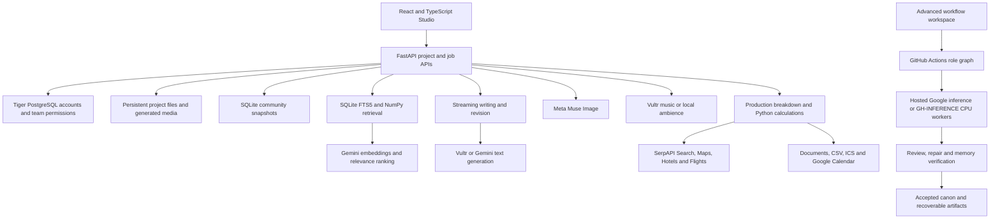

# ParaMyth

### Build a world together. Write it, visualize it, score it, and bring it into production.


[Explore ParaMyth](https://paramyth.tech) · [Architecture](#architecture) · [Run locally](#run-locally) · [Advanced pipelines](docs/pipeline/README.md)

ParaMyth is a collaborative creative platform that carries an idea from its first premise to a shared manuscript, visual world, soundtrack, research dossier, and production plan. Writers and filmmakers work from the same evolving project instead of rebuilding context across disconnected tools.

The implementation combines streaming generation, literary retrieval, scoped model roles, evidence-linked story memory, shared workspaces, multimodal reference materials, and research-backed production logistics. Its advanced execution engine coordinates planning, writing, critique, repair, and memory verification across explicit workflow stages and independent inference runners.

## The creative journey

1. **Discover an idea.** Explore literary traditions on a 3D Story Atlas, search by narrative situation, or begin with an original premise.
2. **Develop it.** Identify missing brief details, request targeted suggestions, and define characters, world rules, medium, and pacing.
3. **Write together.** Stream chapters into an editable manuscript, compare draft versions, review passages, and revise with continuity from earlier writing.
4. **Build the world around it.** Prepare story-aware visuals with Meta Muse Image and generate soundtrack direction and audio with Vultr.
5. **Research and plan.** Develop documentary research dossiers or turn the story into scenes, schedules, budget ranges, travel allowances, and production tasks.
6. **Share the work.** Collaborate in a permissioned studio and explicitly publish project, story, or character snapshots to community Discovery.

## HackTX 2026: implementation highlights

The order below leads with the social creative experience and the integrations that make the most visible, demonstrable contributions to it. Each section links to implementation evidence.

### 1. Meta: a shared visual language for creative collaboration

**Challenge alignment: Bringing People Closer Together with AI.** ParaMyth gives people a shared space to develop stories, discuss ideas, and turn written descriptions into visual references they can understand and build on together.

- **Muse Image integration:** the main studio calls Meta's Responses API with `muse-image-1.0`, an `image_generation` tool request, PNG output, and `store: false`.
- **Narrative-conditioned prompts:** character, scene, location, prop, storyboard, and custom briefs draw on selected project writing and art direction. Optional text-model enhancement separates established descriptions from proposed visual choices.
- **Persistent visual artifacts:** generated files retain their prompt, provider/model, dimensions, status, and SHA-256 digest. Project media can also retain its writing-source identity and signature.
- **Team interpretation:** permissioned studios bring manuscripts, imagery, sound, and production materials into one shared workflow, with discussions and revision conflict handling.
- **Community Discovery:** creators explicitly publish project, story, or character snapshots. Posts support attribution, tags, search, editing, unpublishing, and reporting; publishing a snapshot is separate from exposing a private manuscript.

**Demo:** two creators develop one scene, generate its visual reference, discuss the result, and share an intentional snapshot with the community.

Implementation: [Meta generation](paramyth/image_studio.py), [media source resolution](paramyth/pipeline/media_workspace.py), [team workspaces](paramyth/studio/team_workspace.py), [Discovery](paramyth/studio/discovery.py).

### 2. SerpAPI: production intelligence connected to the real world

**Challenge alignment: Best Use of SerpApi.** ParaMyth translates fictional requirements into dated, regional research and practical production allowances using four search engines.

| Engine | Implementation in ParaMyth |
| --- | --- |
| `google` | Film offices, permit research, published rates, location discovery, documentary source leads. |
| `google_maps` | Catering, passenger transport, camera/lighting/sound suppliers, and nearby medical facilities. |
| `google_hotels` | Dated accommodation searches with room-night rates, amenities, ratings, and location information. |
| `google_flights` | Return-fare leads with airport/date parameters, itinerary information, and travel duration. |

The planner derives travel dates from the shoot schedule, estimates room counts from headcount, and turns structured hotel and flight results into explicit budget allowances. It retains alternatives rather than presenting one result's price as another result's offering.

Research runs through a shared adapter with engine-specific normalization, parameter allowlists, SQLite caching, per-plan and rolling daily limits, credential cooldowns, and ordered key failover. Evidence records preserve public links, retrieval times, and source IDs. Recommendations can cite only supplied IDs; published-rate extraction checks the quote, amount, currency, and billing unit before replacing an estimate.

The documentary workflow adds topic-specific searches for original records, archives, research, and current developments. Optional model synthesis produces a provisional angle, cited claims, timeline, interview questions, proposed sequences, archive leads, and verification tasks. Dossiers export to PDF and Word.

**Demo:** give a scene a real filming region and future shoot dates; inspect local suppliers, hotel/flight leads, the schedule, and the budget they inform. For documentary work, trace a provisional claim to its source lead.

Implementation: [search adapter](paramyth/production_research.py), [production logistics](paramyth/pipeline/production_operations.py), [price evidence](paramyth/pipeline/production_intelligence.py), [documentary research](paramyth/studio/research.py).

### 3. Northmark Compute & Cloud: reusable agent infrastructure

**Challenge alignment: Build the Platform Behind the Agent.** ParaMyth's advanced engine makes model setup, context assembly, role instructions, output contracts, monitoring, and recovery reusable across creative workflows.

- **A common role executor:** `Executor.call(role, packet, instruction, ...)` binds a stage to its context, model policy, output budget, schema, and validator.
- **Composable role responsibilities:** refinement, architecture, character proposals, direction, writing, editing, story/rhetoric review, memory extraction, and independent memory verification.
- **Scoped context construction:** character actors receive visible facts; role-specific literary and craft packets keep inputs relevant to the current task.
- **Policy-driven execution:** configurable hosted/CPU routes, bounded retries, concurrency controls, stage deadlines, model cooldowns, and provider request budgets.
- **Inspectable execution:** saved input packets, model outputs, timing/usage records, event timelines, checkpoints, and explicit failure reports.
- **Reusable workflow families:** sequential canon, parallel-scene reconciliation, living universes, continuation, and targeted recovery.
- **Distributed stages:** GitHub Actions dependencies and matrices execute role stages on separate runners and transfer versioned artifacts between them.

These capabilities form a reusable execution substrate: the same role interface and lifecycle support multiple story modes, model configurations, review policies, and recovery paths. Workflow authors define the intended creative process while the infrastructure handles the repeated mechanics of model invocation, state handoff, validation, and observability.

**Demo:** inspect a scene's role graph, open a scoped input packet, follow an evidence-linked review into a repair, and compare the provisional draft with the accepted checkpoint.

Implementation: [executor](paramyth/pipeline/inference.py), [stage dispatcher](paramyth/pipeline/dag.py), [character proposals](paramyth/pipeline/character_proposals.py), [execution policies](paramyth/pipeline/worker_policy.py), [workflow browser](paramyth/pipeline/api/workflow_browser.py).

### 4. Gemini: semantic discovery and structured narrative intelligence

**Challenge alignment: Best Use of Gemini API.** Gemini powers both retrieval and configurable text-generation stages.

- **Literary embeddings:** `gemini-embedding-001` generates normalized 768-dimensional vectors with separate `RETRIEVAL_DOCUMENT` and `RETRIEVAL_QUERY` task types.
- **Hybrid retrieval:** NumPy cosine comparison combines with SQLite FTS5/BM25 keyword rankings. Advanced retrieval supports weighted query facets, narrative-mechanism overlap, explicit references, and source grouping.
- **Relevance explanations:** the hosted idea-search path can use a Gemini text model to rerank supplied candidate IDs and explain direct and related matches. Earlier retrieval results remain available if reranking fails.
- **Structured writing:** the interactive stream adapter supports Gemini JSON responses and schemas. Advanced model policies route writing, development, editing, review, and memory work to configured Google models.
- **Traceable retrieval:** encoder versions, corpus fingerprints, source IDs, and projection checks help prevent stale or incompatible reference material from silently entering a run.

Retrieved references become selected text and metadata in role packets. The interactive writer also builds continuity directly from saved project writing; retrieval is not automatically invoked for every chapter request.

Implementation: [embedding encoder](paramyth/pipeline/rag/embeddings.py), [retrieval](paramyth/pipeline/retrieval.py), [reranking](paramyth/pipeline/rag/rerank.py), [stream adapter](paramyth/pipeline/creative_stream.py), [Google routing](docs/pipeline/google-routing.md).

### 5. Vultr: generation across writing, sound, and production

**Challenge alignment: Best Use of Vultr.** The integration uses Vultr Serverless Inference as a multimodal creative backend.

- **Creative text:** `muse-glimmer-30b` develops ideas, drafts chapters, reviews writing, and applies revisions through Chat Completions. The interactive provider selection prefers Vultr when its inference key is configured.
- **Production reasoning:** the same text integration extracts scene requirements and develops operational plans, resource estimates, location criteria, and research-backed recommendations.
- **Soundtracks:** music-model discovery and asynchronous music jobs support generation, capability checks, status tracking, playback, and downloads. Direction can be derived from selected writing or supplied explicitly.
- **Visual development:** text generation can enhance image prompts. The separate advanced image backend can discover Vultr image models and supports a recorded backup path after Meta failure; the main studio renderer uses the Meta-specific module.
- **Separated credentials:** dedicated production and music keys can be configured independently of the general inference key.

Local procedural ambience provides another audio path. Music duration, lyrics, and instrumental support are validated against the selected provider model's capabilities.

Implementation: [creative engine](paramyth/pipeline/creative_studio.py), [production reasoning](paramyth/pipeline/production.py), [music integration](paramyth/pipeline/soundtracks.py), [advanced image backend](paramyth/pipeline/image_studio.py).

### 6. Tiger Data: durable identity and permissioned creative teams

**Challenge alignment: Best Use of Tiger Data.** Tiger Cloud/PostgreSQL provides the relational foundation for accounts and studios through Psycopg.

- Users, salted scrypt password hashes, expiring/revocable sessions, persistent authentication throttling, studios, memberships, and invitations.
- Owner/admin/editor/viewer authorization enforced on server requests, plus project revision/comment tables used by collaboration APIs.
- Explicit, transactional migrations, a separate restricted runtime role, parameterized SQL, and certificate-verified TLS.
- A team runtime that shares project files and jobs while keeping each member's Calendar authorization and workspace selection personal.

The full creative workspace additionally persists manuscripts, drafts, media, and jobs on disk. Tiger holds identity and relational collaboration data; literary vectors and community Discovery use separate SQLite stores. Backups must include the database, workspace volume, and encryption key.

**Demo:** sign in as two members, open a shared project, observe saved changes, then compare editor and viewer permissions.

Implementation: [database and migrations](paramyth/studio/studio_db.py), [sessions](paramyth/studio/studio_security.py), [studio API](paramyth/studio/studios.py), [database setup](docs/TIGER.md).

### 7. .TECH and the infrastructure around the experience

**Additional challenge alignment: Best Domain from .TECH.** `paramyth.tech` gives the public creative studio a distinct project identity. GitHub Pages builds and publishes the frontend, Railway runs the documented FastAPI deployment with persistent storage, and Google Calendar OAuth connects a creator's schedule to their own account. These complement the generation providers with a navigable product, durable work, and practical exports.

The opening-ceremony deck limits entries to three tracks excluding Overall/Novice. For a focused judging narrative, lead with **Meta's collaborative creative experience**, **SerpAPI's production intelligence**, and **Northmark's reusable agent infrastructure**; the Gemini, Vultr, Tiger, and .TECH sections explain the additional engineering behind that demonstration. Confirm final submission selections against the event's current form.

## Architecture



### Writing, revision, and source-aware media

The browser submits an operation and project identity. The backend resolves the authorized workspace, validates the input, loads the brief and relevant earlier writing, and starts a persisted background job. For chapter generation, context includes selected draft versions and manual edits from up to eight earlier scene/chapter entries, within text budgets.

Provider output streams into Python, which extracts safe partial JSON fields, saves previews, and publishes job progress through server-sent events. Completed output is validated and retained as a generation record. Manual edits are tied to their base draft; saving to the manuscript is explicit. Targeted revisions must resolve to one source passage before the replacement is inserted.

The media resolver can select the active chapter, latest writing, a specific generation, the manuscript, or a standalone brief. Source signatures identify the input snapshot used for imagery, soundtrack direction, and production planning. Finished assets stay attached to the material that produced them as the project evolves.

### Production calculations and research

Models propose filmable scenes and resource rows. Python validates them, constructs a dependency-aware single-unit shooting schedule, and calculates low/high budget ranges with `Decimal`. Scheduling considers availability, setup and moves, meal breaks, lighting groups, and turnaround. Crew quantities account for headcount and working days; detailed logistics adds room-night and per-traveler allowances from research.

Recalculation can update schedules and budgets without another model call. Exports include Word/PDF dossiers, schedule/budget/task CSVs, tentative calendar files, call sheets, and JSON. Google Calendar uses per-user OAuth, checks overlapping events, and uses stable event identities to avoid duplicates.

### Shared work and recovery

Team edits autosave after a short debounce. Visible team workspaces refresh periodically, with revision and field-hash checks preventing silent stale writes. Conflicts retain local edits for comparison. Discussions refresh separately; writing jobs use streaming progress. This is near-real-time collaboration with explicit conflict handling.

Project files use temporary writes, flush/fsync, and atomic replacement. Generated work has saved status and result records. Browser reconnection watches existing jobs rather than automatically resubmitting generation. Advanced runs additionally preserve scoped packets, reviews, evidence bindings, and resumable checkpoints.

## Advanced narrative orchestration

The interactive studio provides direct writing/review/revise actions. For larger experiments, `paramyth.pipeline` provides an explicit role graph:

```text
Request + retrieval
  -> refinement and development review
  -> outline and scene design
  -> isolated character proposals
  -> director -> writer -> editor
  -> story review | rhetoric review | memory extraction
  -> bounded repair and refreshed checks
  -> independent memory verification
  -> acceptance, canon, and next scene
```

Parallel branches share the intended candidate/state snapshot. Evidence can bind to paragraph IDs, source offsets, and a prose hash; changed prose requires matching checks. Accepted facts remain in an append-only history with validated supersession. Character visibility is applied before projecting current knowledge, allowing an uninformed character to retain an older belief.

The reusable `Executor` combines role instructions, schemas, validators, model selection, call budgets, output caching, and diagnostics. Some workflows distribute stages across GitHub Actions jobs, with character matrices and independent review branches. GH-INFERENCE and llama.cpp can execute CPU models on the allocated runner; other routes call hosted Google models. Main studio chapter requests run on the application backend and do not automatically dispatch Actions.

See [the pipeline guide](docs/pipeline/README.md), [three story modes](docs/pipeline/THREE_MODES.md), [API routes](docs/pipeline/API.md), and [runner workflow](.github/workflows/story.yml). Foundation `paramyth` checkpoints and advanced `paramyth.pipeline` checkpoints use different formats; retain each run with its originating engine.

## Technology stack

| Layer | Technologies |
| --- | --- |
| Frontend | React 19, TypeScript, Vite 8, pnpm, Tailwind CSS 4, custom CSS, Anime.js. |
| Geographic discovery | Three.js, Leaflet, marker clustering, D3 Geo, TopoJSON, World Atlas/Natural Earth data. |
| Backend | Python 3.11+, FastAPI, Uvicorn, Pydantic and application validators, thread-pool jobs, SSE. |
| Relational persistence | Tiger Cloud/PostgreSQL, Psycopg, explicit SQL migrations. |
| Retrieval and local stores | SQLite FTS5, NumPy, Gemini embeddings; SQLite research cache and Discovery store. |
| Generation | Meta Model API, Vultr Serverless Inference, Google Generative Language API. |
| Research | SerpAPI Google Search, Maps, Hotels, and Flights engines. |
| Exports and scheduling | python-docx, ReportLab, Decimal, timezone-aware Python scheduling, Google Calendar OAuth/API. |
| Execution and hosting | GitHub Actions/Pages, GH-INFERENCE, llama.cpp, Docker, Railway; optional Caddy/Compose. |

## Run locally

Requirements: Python 3.11+, Node.js 22.12+ or 24, and pnpm. Use a virtual environment for Python dependencies.

```sh
git clone https://github.com/TanishC4444/ParaMyth.git
cd ParaMyth
python -m venv .venv
```

Activate with `source .venv/bin/activate` on macOS/Linux or `.venv\Scripts\Activate.ps1` in Windows PowerShell. Then:

```sh
python -m pip install -e ".[studio,tiger,api,rag,docx,hosted,production,test]"
cd frontend
pnpm install --frozen-lockfile
pnpm build
cd ..
python -m paramyth.studio.serve --port 8770
```

Open **http://127.0.0.1:8770**. The bundled Story Atlas can be explored without model credentials; generation requires the relevant server connections.

For local personal mode, leave `PARAMYTH_ACCOUNT_WORKSPACES` unset or set it to `0`, and leave `PARAMYTH_PUBLIC_ORIGIN` unset. The sample environment file enables hosted account mode, so configure it deliberately rather than copying its hosted defaults unchanged. Server settings load from root `.env`, `deploy/.env`, or the owner-selected `PARAMYTH_ENV_FILE`; process values take precedence.

For frontend development, run `pnpm dev` inside `frontend/`; its backend proxy defaults to port 8770. Build `frontend-pipeline/` separately and run `paramyth-pipeline-studio --port 8770` for the advanced workspace instead of the main launcher.

### Provider configuration

Use [.env.example](.env.example) as the variable reference. Configure only the services you need; actual credentials stay in the backend environment or an ignored settings file.

| Variable | Enables |
| --- | --- |
| `MUSE_IMAGE_API_KEY` | Meta Muse Image. `MODEL_API_KEY` is an accepted alias. |
| `GEMINI_API_KEY` | Embeddings, relevance ranking, and supported Gemini text paths. |
| `GEMINI_API_KEYS` | Optional JSON backup array for supported Google clients; full pool routing is an advanced-client feature. |
| `VULTR_INFERENCE_API_KEY` | Creative text, prompt enhancement, and general Vultr inference. |
| `VULTR_PRODUCTION_API_KEY` | Optional dedicated production-planning connection. |
| `VULTR_MUSIC_API_KEY` | Optional dedicated music connection. |
| `SERPAPI_API_KEY`, `SERPAPI_BACKUP_KEYS` | Cached web/travel/local research; backups are comma-separated. |
| `PARAMYTH_DATABASE_URL` | Restricted Tiger/PostgreSQL runtime connection. |
| `PARAMYTH_ENCRYPTION_KEY` | Persistent Fernet key required for hosted account workspaces. |
| `GOOGLE_CLIENT_ID`, `GOOGLE_CLIENT_SECRET` | Optional per-user Calendar authorization. |

Do not put provider secrets into frontend build variables. A split frontend uses `VITE_API_BASE` only for the public backend origin. Google model IDs and provider capabilities are configuration choices; live account access and quotas must be checked independently.

### Hosted accounts and teams

Follow [Tiger setup](docs/TIGER.md) to run migrations explicitly with `PARAMYTH_MIGRATION_DATABASE_URL` and grant a separate application role. Set `PARAMYTH_ACCOUNT_WORKSPACES=1`, a durable `PARAMYTH_WORKSPACE`, and a stable encryption key. Database migrations do not run automatically at startup.

For deployment, see [hosting and persistent workspaces](docs/HOSTING.md) and [Railway with a GitHub Pages frontend](deploy/railway.md). Run one application process/replica against the persistent workspace volume. Provider credentials stay server-side, sessions use HttpOnly cookies, and each user connects their own Calendar.

## Verification

Backend checks use fixtures and mocked providers unless a test explicitly requires external configuration. PostgreSQL integration tests require a disposable database. Linux is the reference environment for the full advanced runner suite; some advanced accounting code currently imports Unix-only `fcntl`.

```sh
python -X utf8 -m unittest discover -s tests -v
```

Frontend checks:

```sh
cd frontend
pnpm exec tsc --noEmit
pnpm test:atlas
pnpm test:cinematic
pnpm test:site
pnpm build
```

GitHub Actions includes contract/storage tests, retrieval, editorial integration, studio/account checks, frontend checks, and deployment. Live generation workflows are explicitly dispatched. Fixture success verifies orchestration and contracts; it does not establish live provider availability or literary quality.

## Repository map

| Path | Contents |
| --- | --- |
| `frontend/` | Main studio, account entry, Story Atlas, Discovery, research, writing, and production UI. |
| `frontend-pipeline/` | Advanced workflow workspace. |
| `paramyth/studio/` | Main FastAPI application, accounts, teams, research, Discovery, jobs, and private media. |
| `paramyth/pipeline/` | Advanced narrative orchestration, role execution, memory, retrieval, and production tools. |
| `paramyth/` | Foundation coordinator, shared provider adapters, storage, and compatibility CLIs. |
| `data/`, `skills/`, `examples/` | Literary records/index, role guidance, and example requests. |
| `.github/`, `scripts/` | Runner graphs, CI/deployment, workflow builders, and developer tools. |
| `deploy/`, `docs/`, `tests/` | Hosting, detailed guides, and validation suites. |

## Current boundaries and provenance

Generation and synthesis remain editable proposals. Automated reviews can miss contradictions; preserved history does not guarantee that every old fact fits in a working context. Production schedules are heuristic single-unit plans, prices are estimates or dated leads, and permits/availability require confirmation. The integrations research and prepare work; they do not book travel or secure permissions.

Long-running generation depends on the hosting process. Saved files survive on a persistent volume, while interrupted execution may require inspection or explicit recovery. Main and advanced image/provider paths differ; use the source-linked implementation and dedicated guides for exact capabilities.

Original project code is [MIT licensed](LICENSE). External libraries, model terms, corpus sources, and artwork retain their own terms and attribution. [PROVENANCE.json](PROVENANCE.json) records upstream components; [art credits](frontend/public/art/manifest.json) and [geography sources](frontend/public/atlas/GEOGRAPHY.md) document bundled reference assets. Curated artwork and fixture stories are distinct from new generated results.
