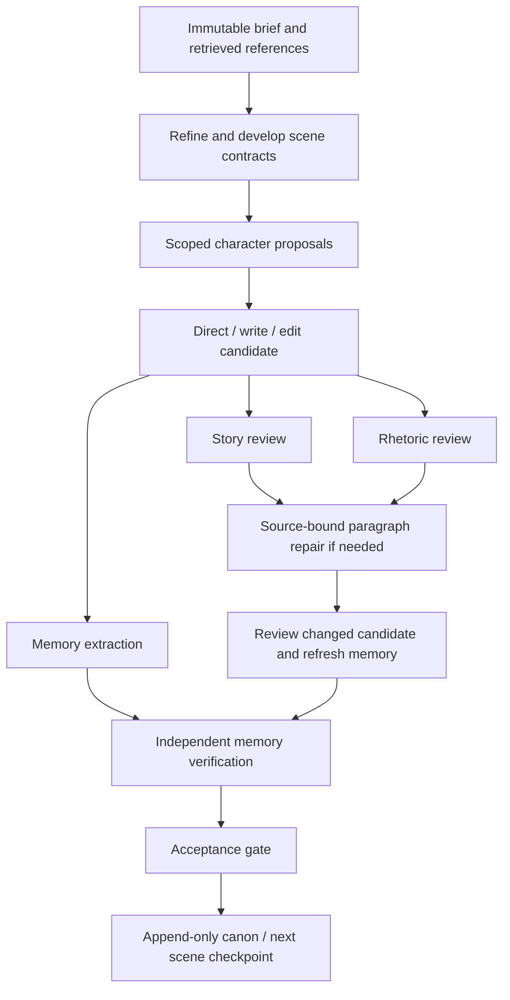

# How ParaMyth works

[Project overview](../README.md) · [Engineering evidence](ENGINEERING.md) · [Provider details](INTEGRATIONS.md)

ParaMyth has two execution surfaces sharing creative and production components:
the interactive studio and the advanced workflow workspace. Their persistence,
context, and acceptance rules should be understood separately.

## 1. Interactive studio: request to durable creative artifact

1. [React](../frontend/src/App.tsx) selects a personal or team project. Account gates
   and the workspace picker establish the active identity and studio.
2. [FastAPI assembly](../paramyth/studio/app.py) installs host/origin, account,
   workspace, and CSRF dependencies before including the author/media routers.
3. [Runtime](../paramyth/studio/runtime.py) resolves a project folder and submits a
   bounded background job. Each runtime has two worker threads and at most four
   queued/running jobs; these are limits per runtime, not global deployment limits.
4. [Creative studio](../paramyth/pipeline/creative_studio.py) assembles the brief,
   selected writing, and bounded prior-chapter context. Interactive continuity is
   not the advanced engine's complete evidence-gated canon pipeline.
5. [Streaming transport](../paramyth/pipeline/creative_stream.py) decodes provider
   SSE, preserves complete Unicode characters in partial JSON previews, and checks
   finish reasons and response structure. A partial draft is not a finished result.
6. Project records retain job state, previews, outputs, and usage when supplied.
   [Atomic saves](../paramyth/storage.py) write temporary files, flush/fsync, and
   replace the destination. Manuscript adoption and targeted revision are explicit.

Saved job records survive a process restart; the running Python work does not.
The runtime marks queued/running records `interrupted` on startup rather than
claiming they resumed. The current design is a persisted in-process worker pool,
not a distributed task queue. Use a single process/replica for a shared workspace.

## 2. Storage ownership

| Data | Storage | Relevant code |
| --- | --- | --- |
| Accounts, sessions, roles, memberships, invitations, SQL revisions/comments | PostgreSQL/Tiger | [Database](../paramyth/studio/studio_db.py), [studios](../paramyth/studio/studios.py) |
| Manuscripts, drafts, media, job outputs, author revisions | Persistent project files | [Runtime](../paramyth/studio/runtime.py), [workspace API](../paramyth/pipeline/api/ui_workspace.py) |
| Literary records, vectors, full-text index, corpus metadata | Bundled SQLite database | [RAG store](../paramyth/rag/db.py) |
| Search responses, rolling quota reservations, key cooldowns | Per-workspace SQLite cache | [SerpAPI adapter](../paramyth/production_research.py) |
| Explicit community snapshots and reports | Separate SQLite store | [Discovery](../paramyth/studio/discovery.py) |
| Personal project selection and Calendar authorization | Member-specific runtime/preferences | [Team runtime](../paramyth/studio/team_workspace.py) |

PostgreSQL is not the vector store. Publishing a community snapshot does not
publish the private project directory. File artifacts, relational identity data,
and the encryption key must all be retained for a complete hosted backup.

## 3. Hybrid literary retrieval

The source corpus contains 605 analysis records, of which 603 are enabled.
Each index row contains its projection, source JSON, identity, and a normalized
768-dimensional Gemini vector. Two disabled rows stay in the source/index but
are excluded from retrieval.

The [main search](../paramyth/rag/db.py) performs these steps:

1. Validate query, limit, semantic weight, encoder version, and corpus fingerprint.
2. Filter enabled rows by requested type/location.
3. Rank lexical candidates with SQLite FTS5/BM25.
4. If the semantic weight is positive, embed the query, normalize it, and compute
   cosine similarities using a NumPy matrix/vector product. A zero semantic weight
   makes keyword search available without provider credentials.
5. Combine semantic and keyword ranks using weighted reciprocal-rank fusion;
   apply the selected source-diversification policy and return traceable IDs.

[Ingestion](../paramyth/rag/ingest.py) compares projected content before embedding.
It resumes unchanged rows, invalidates the completed fingerprint while batches
are outstanding, and publishes the new fingerprint only after ingestion completes.
The bundled database is tested as delivered, not just reconstructed in a temporary
unit-test fixture.

The [advanced retriever](../paramyth/pipeline/retrieval.py) additionally builds
weighted query facets, scores controlled narrative-mechanism overlap, pins explicit
references, groups sources, and builds role-specific craft packets. That path uses
its own projection/version checks. Model-authored analyses retain source limits;
retrieval relevance is not proof of literary influence or writing quality.

## 4. Agent execution, evidence, and acceptance

- [Executor](../paramyth/pipeline/inference.py) binds a role to its instructions,
  packet, model route, output schema, retries, call cache, and diagnostics.
- [Native Actions stages](../paramyth/pipeline/dag.py) transfer artifacts between
  separate runners. Character matrices and independent review branches can overlap;
  later accepted scenes still depend on earlier committed state. Actual overlap
  depends on runner availability.
- [Evidence binding](../paramyth/pipeline/evidence.py) records paragraph IDs, exact
  character offsets, and a SHA-256 hash of the candidate prose. Unknown passage
  IDs and stale source hashes are rejected. Legacy quote matching has a separate,
  restricted normalization path.
- [Targeted patches](../paramyth/pipeline/patching.py) verify the source hash and
  replace only addressed paragraph spans. Conflicting proposed replacements require
  a focused edit rather than silently overwriting one another.
- [Canon](../paramyth/pipeline/canon.py) keeps append-only history. Supersession
  must cite an earlier record with a matching fact key and kind. Actor knowledge
  is filtered before projecting current state, so an uninformed character can
  retain an older belief.
- [Three modes](pipeline/THREE_MODES.md) define sequential acceptance, parallel
  scene reconciliation, and resumable living universes. Explicit provisional
  continuation may retain drafts with unresolved checks; those are not relabelled
  as strict passes or published canon.

The interactive studio's direct chapter generation is not this whole graph.
Evidence integrity prevents stale or invented references from passing structural
validation; it cannot guarantee that a model's interpretation is true.

## 5. Story requirements to a production plan

[Planner](../paramyth/pipeline/production.py) requests a structured breakdown, then
validates and calculates the plan in Python. Models propose scene/resource rows;
they do not author authoritative arithmetic.

- **Scheduling:** resolve scene dependencies and cast/location availability; add
  setup and location moves; separate day/night groups; allow meal breaks and
  12-hour turnaround. This is a single-unit heuristic bounded to a one-year search,
  not a globally optimal schedule or a solar/weather prediction.
- **Budgeting:** multiply validated quantities by low/high rates using `Decimal`,
  add contingency, flag the budget ceiling, and retain unknown/excluded costs.
- **Operations:** [18 department definitions](../paramyth/pipeline/production_operations.py),
  at most 40 tasks, and cycle-checked dependencies connect preparation, filming,
  and post-production. Owner conflicts shift task times; infeasible lead times
  produce explicit conflicts.
- **Research:** four SerpAPI engines supply public leads and structured travel
  data. Hotel dates come from the shoot schedule; room counts come from headcount.
  Fare/hotel alternatives retain their own source identity and rates.
- **Price evidence:** [rate replacement](../paramyth/pipeline/production_intelligence.py)
  requires supplied source IDs, a verbatim quote, matching numeric amounts,
  currency, and billing unit. Search snippets remain leads rather than booking quotes.
- **Recalculation:** [the API](../paramyth/studio/planning.py) recomputes schedules
  and budgets without another model call and flags previous logistics research stale.
- **Exports:** schedule/budget/task CSVs, ICS, JSON, PDF/DOCX dossiers, and call
  sheets connect the plan to external workflows. [Calendar sync](../paramyth/calendar_sync.py)
  checks overlap and uses stable event identities to avoid duplicate inserts.

[SerpAPI transport](../paramyth/production_research.py) caches legal research for
6 hours and other research for 24 hours. `BEGIN IMMEDIATE` serializes rolling
24-hour allowance reservations in a shared SQLite database. Up to three ordered
keys are considered; exhausted credentials cool down for one hour. Malformed
structured responses raise a controlled provider error and never enter the cache.
A quota reservation represents an attempted provider call, including failed calls.

## 6. Team edits and source-aware media

[Team runtime](../paramyth/studio/team_workspace.py) shares project files/jobs
while preserving each member's selection and Calendar context. Owner/admin/editor
roles can mutate permitted workspace content; viewers can read. Shared author
updates compare project revision hashes, while draft fields have individual
hashes; stale writes return HTTP 409. Browser refresh/polling plus explicit
conflict handling provides collaboration without an OT/CRDT editing claim.

[Media source resolution](../paramyth/pipeline/media_workspace.py) identifies the
selected chapter, manuscript, generation, or manual brief. A writing signature
records the source snapshot used for imagery, music, or production. Reference-image
uploads have their own project-owned validated store. The main image path calls
Meta; optional advanced image routing and fallback are separate paths.

Passwords use salted scrypt; sessions store token hashes and expire/revoke.
Host/origin and CSRF checks run on the server. These mechanisms and tests support
specific access guarantees; they are not a security certification.

## 7. Evaluation and practical limits

The [matched continuity demos](../demos/README.md) compare plain and managed arms
on three predefined scenarios using the same writing model. They retain partial
failures, account for known versus unknown usage, and use source-bound anonymous
judge output. The managed arm spends extra calls. No speedup, equal-compute win,
statistical quality advantage, or long-context scalability is established.

Local tests use deterministic fixtures and mocked paid providers. PostgreSQL
integration tests need a disposable database. Deployment health, paid-account
availability, model output quality, and Calendar consent need separate live checks.
